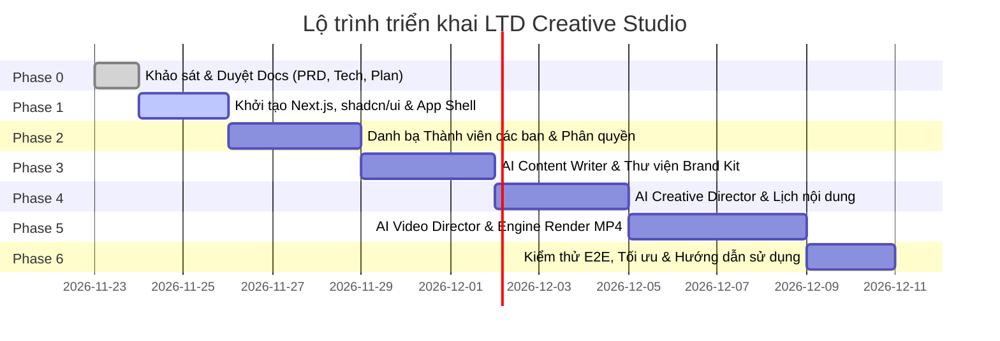

# PROJECT PLAN & IMPLEMENTATION ROADMAP — LTD CREATIVE STUDIO
**Dự án:** LTD Creative Studio (Long Thành Digital Photo Club)  
**Tài liệu:** Kế hoạch triển khai theo từng Phase & Task chi tiết  
**Phiên bản:** 1.0  
**Ngày lập:** 23/11/2026  

---

## 1. NGUYÊN TẮC "VIBE CODING CÓ KIỂM SOÁT" CÙNG ANTIGRAVITY

Để "Vibe Coding" tạo ra một sản phẩm chạy thật, ổn định và chuyên nghiệp (thay vì chỉ là một giao diện mock đẹp mắt nhưng vô hồn), bạn và Antigravity sẽ tuân thủ nguyên tắc **5 Bước Vibe Coding Chuẩn**:

1. **Khóa Kiến trúc & Yêu cầu trước khi gõ code:** Đọc kỹ PRD và Tech Architecture, thống nhất cấu trúc dữ liệu và luồng đi của dữ liệu.
2. **Chia nhỏ tính năng thành các Milestone độc lập (M0 -> M6):** Không bao giờ yêu cầu AI "viết toàn bộ web app trong 1 câu prompt". Mỗi lần làm việc chỉ tập trung giải quyết dứt điểm 1 module nhỏ.
3. **Thực thi và Kiểm chứng thực tế (Real Execution):** 
   - Không chấp nhận câu trả lời "đã xong" nếu chưa chạy `npm run build`, chưa gọi API thật, hoặc chưa xuất ra file thật.
   - Với tính năng video: chỉ coi là hoàn thành khi xuất ra được file `.mp4` phát được trên máy tính.
4. **Sử dụng Agent Skills chuyên biệt:** 
   - Tận dụng `hyperframes` cho video rendering.
   - Tận dụng `supabase` cho cơ sở dữ liệu và bảo mật RLS.
   - Tận dụng `react-best-practices` và `frontend-design` cho UI mượt mà.
5. **Giữ nguyên trạng thái đã hoạt động (Preserve working state):** Không tùy tiện viết lại toàn bộ mã nguồn khi sửa lỗi nhỏ; luôn backup và commit Git sau mỗi milestone hoàn tất.

---

## 2. LỘ TRÌNH TRIỂN KHAI CHI TIẾT (PHASE & SPLIT TASKS)

---

### PHASE 0: DISCOVERY & ARCHITECTURE (ĐANG THỰC HIỆN)
*Mục tiêu: Hoàn thiện toàn bộ tài liệu đặc tả, kiến trúc và kế hoạch trước khi sinh mã nguồn.*
- [x] **Task 0.1:** Phân tích tài liệu gốc (`README.md`, `MASTER_PROMPT_ANTIGRAVITY.md`, `SKILLS_INSTALL_GUIDE.md`).
- [x] **Task 0.2:** Viết tài liệu yêu cầu sản phẩm (`docs/PRD.md`).
- [x] **Task 0.3:** Thiết kế kiến trúc kỹ thuật & giải mã pipeline video (`docs/TECH_ARCHITECTURE.md`).
- [x] **Task 0.4:** Lập kế hoạch phân bổ task chi tiết (`docs/PLAND.md`).
- [x] **Task 0.5:** Project Owner duyệt qua buổi phỏng vấn định hướng (/grill-me) và thống nhất 5 quyết định kiến trúc:
  1. Mô hình triển khai: Hybrid (Next.js + Gemini API + local FFmpeg + sẵn sàng Supabase Cloud).
  2. Video Engine: HyperFrames + FFmpeg (chuẩn theo Agent Skills).
  3. API Key: .env.local kết hợp giao diện cấu hình Settings.
  4. Danh bạ: Bắt đầu từ Empty State chuẩn, hỗ trợ nhập thành viên thật & import CSV.
  5. UI Theme: Auto System preference với nút gạt Dark/Light Mode.

---

### PHASE 1: FOUNDATION & DESIGN SYSTEM (NỀN TẢNG & GIAO DIỆN CHÍNH) - HOÀN TẤT
*Mục tiêu: Xây dựng bộ khung Next.js chuẩn, cài đặt giao diện shadcn/ui, hệ thống điều hướng và mock data adapter.*
- [x] **Task 1.1:** Khởi tạo dự án Next.js 16 (App Router, TypeScript, Tailwind CSS, ESLint).
- [x] **Task 1.2:** Thiết lập hệ thống UI Components (lucide-react, clsx, tailwind-merge, next-themes).
- [x] **Task 1.3:** Xây dựng Layout Workspace (Sidebar thu gọn được trên mobile, Header chứa Title/Trạng thái/Theme, Content Area).
- [x] **Task 1.4:** Thiết kế bảng màu chủ đạo (LTD Theme: Deep Navy, Modern Slate, Accent Cyan) và hỗ trợ Dark/Light/System mode tự động theo yêu cầu.
- [x] **Task 1.5:** Tạo khung màn hình Dashboard tổng quan với các metric cards, launchpad 3 AI modules, và cơ cấu 4 ban CLB.
- [x] **Task 1.6:** Dựng sẵn khung các màn hình: AI Content Writer (/writer), AI Creative Director (/director), AI Video Editor (/video), Danh bạ thành viên (/members), Lịch nội dung (/calendar), Thư viện (/library), Cài đặt API (/settings).
*Tiêu chí nghiệm thu M1:* Ứng dụng build thành công với 0 lỗi (`npm run build` pass 100%), chuyển đổi mượt mà giữa các tab và theme Dark/Light.

---

### PHASE 2: MEMBER DIRECTORY & DEPARTMENTS (QUẢN LÝ THÀNH VIÊN 2 BAN: TRUYỀN THÔNG & KỸ THUẬT) - HOÀN TẤT
*Mục tiêu: Triển khai danh bạ thành viên CLB LTD theo 2 ban chính thức, lưu trữ dữ liệu bền vững và bảo vệ quyền riêng tư.*
- [x] **Task 2.1:** Thiết lập mô hình dữ liệu cho 2 Ban chính thức (Ban Truyền Thông & Ban Kỹ Thuật) trong `src/lib/types/member.ts`.
- [x] **Task 2.2:** Xây dựng cơ chế lưu trữ dữ liệu bền vững qua API route `src/app/api/members/route.ts` (lưu trữ file `data/members.json`).
- [x] **Task 2.3:** Hoàn thiện giao diện Danh bạ `/members`: Bộ lọc theo 2 Ban (Truyền Thông vs Kỹ Thuật), tìm kiếm tức thời theo tên, chức vụ, kỹ năng (tags).
- [x] **Task 2.4:** Form Thêm/Chỉnh sửa/Xóa thành viên (CRUD đầy đủ, hỗ trợ quản lý thẻ kỹ năng #tags).
- [x] **Task 2.5:** Tính năng Import & Export danh sách thành viên ra/vào file CSV (tương thích bảng mã tiếng Việt Excel UTF-8 BOM).
- [x] **Task 2.6:** Áp dụng quy chuẩn bảo vệ dữ liệu cá nhân theo Master Prompt (chỉ hiện thông tin công khai trong CLB).
*Tiêu chí nghiệm thu M2:* Thêm, sửa, xóa thành viên hoạt động trơn tru; dữ liệu được lưu bền vững; import/export CSV chính xác theo 2 ban; build pass 100%.

---

### PHASE 3: LTD KNOWLEDGE BASE & AI CONTENT WRITER (MODULE VIẾT BÀI AI) - HOÀN TẤT
*Mục tiêu: AI tạo caption, bài đăng Facebook và kịch bản TikTok có kiểm soát dữ kiện.*
- [x] **Task 3.1:** Xây dựng Thư viện Tri thức (LTD Library / Knowledge Base) nhúng thông tin CLB, tôn chỉ và cơ cấu 2 ban trong `src/lib/ai/gemini.ts`.
- [x] **Task 3.2:** Tích hợp Server-side Adapter gọi Google Gemini API qua SDK chính thức `@google/genai` (hỗ trợ đọc GEMINI_API_KEY từ `.env.local` hoặc header/body override).
- [x] **Task 3.3:** Xây dựng Server API endpoint `/api/ai/writer` tiếp nhận form đầu vào có cấu trúc (Nền tảng, Loại bài, Giọng văn, Chủ đề, Dữ kiện xác thực).
- [x] **Task 3.4:** Thiết kế System Prompt chuẩn chống bịa đặt dữ kiện (Anti-Hallucination): bắt buộc chèn placeholder `[CẦN XÁC MINH: ...]` nếu thiếu ngày/giờ/địa điểm, xuất ra JSON chuẩn (Hook, Body, Hashtags, VisualTips cho Ban Kỹ Thuật, FactsChecklist).
- [x] **Task 3.5:** Cập nhật UI `/writer` kết nối API thật, hỗ trợ chỉnh sửa trực tiếp, sao chép 1-click, và lưu bản nháp vào thư viện.
- [x] **Task 3.6:** Xây dựng API lưu bản nháp `/api/content` (lưu bền vững trong `data/content.json`) và hiển thị trực tiếp tại Thư viện bài viết (`/library`).
*Tiêu chí nghiệm thu M3:* Nhập thông tin sự kiện -> Gemini sinh ra bài viết Facebook/TikTok chuẩn form, không bịa đặt ngày giờ nếu chưa cung cấp; lưu và xem được bài trong thư viện; build pass 100%.

---

### PHASE 4: AI CREATIVE DIRECTOR & CONTENT CALENDAR (Ý TƯỞNG & LỊCH NỘI DUNG) - HOÀN TẤT
*Mục tiêu: Brainstorm ý tưởng, lập kế hoạch chiến dịch và hiển thị lịch đăng bài.*
- [x] **Task 4.1:** Xây dựng giao diện AI Creative Director (`src/app/director/page.tsx`) theo phong cách thiết kế tím/lavender cao cấp.
- [x] **Task 4.2:** Tích hợp Server API endpoint `/api/ai/director` gọi Google Gemini AI thật, sinh ra danh sách Concept sáng tạo hoàn chỉnh (Big Idea, Shot list góc quay cho Ban Kỹ Thuật, Thiết bị cần chuẩn bị, Timeline).
- [x] **Task 4.3:** Xây dựng API lưu trữ ý tưởng `/api/ideas` (lưu bền vững trong `data/ideas.json`) và tính năng 1-click **"Đưa Vào Lịch"**.
- [x] **Task 4.4:** Nâng cấp Lịch nội dung (`src/app/calendar/page.tsx`) kết nối API `/api/calendar`: hiển thị lưới tháng 30 ngày, danh sách sự kiện sắp diễn ra, modal thêm sự kiện mới.
- [x] **Task 4.5:** Kiểm thử biên dịch và đồng bộ dữ liệu giữa ý tưởng và lịch phát hành.
*Tiêu chí nghiệm thu M4:* Sinh được 3-4 concept sáng tạo có shot list chi tiết cho Ban Kỹ Thuật, lưu thẻ ý tưởng và đưa trực tiếp vào lịch nội dung thành công; build pass 100%.

---

### PHASE 5: AI VIDEO DIRECTOR & EDITOR MVP (BIÊN TẬP VIDEO TỰ ĐỘNG) - HOÀN TẤT
*Mục tiêu: Đưa video gốc qua pipeline phân tích, sinh kịch bản EDL và render ra file MP4 thực tế.*
- [x] **Task 5.1:** Cài đặt và kích hoạt thành công FFmpeg & FFprobe H.264/AAC trên Windows (`@ffmpeg-installer/ffmpeg` & `@ffprobe-installer/ffprobe`).
- [x] **Task 5.2:** Xây dựng mô hình dữ liệu cho Video Clips, Shot, Edit Decision List (EDL) và Render Jobs (`src/lib/types/video.ts`).
- [x] **Task 5.3:** API Upload & Quản lý Clip Video Raw (`/api/video/upload`): hỗ trợ nhận video clip, lưu trữ, trích xuất metadata và frame thumbnail tự động.
- [x] **Task 5.4:** AI Video Director (`/api/video/generate-edl`): Gemini phân tích các clip nguồn, định hình Hook 3s, thân video và xuất ra EDL JSON chuẩn.
- [x] **Task 5.5:** Rendering Engine (`/api/video/render` & `src/lib/video/ffmpeg.ts`): Cắt, crop/scale theo tỷ lệ 9:16 (TikTok/Reels), ghép video theo EDL và xuất ra file `.mp4` thật xem được.
- [x] **Task 5.6:** Giao diện Interactive Video Studio (`/video`): Timeline trực quan cho Ban Kỹ Thuật chỉnh sửa text phụ đề, cắt thời lượng shot, và trình phát video MP4 kèm nút tải về.
*Tiêu chí nghiệm thu M5:* Upload clip -> AI sinh EDL -> Ban Kỹ Thuật chỉnh sửa timeline -> Bấm render và nhận file MP4 thật phát được trên trình duyệt; build pass 100%.

---

### PHASE 6: SYSTEM INTEGRATION, SECURITY & OPERATIONAL HANDOVER - HOÀN TẤT
*Mục tiêu: Kiểm thử toàn diện, bảo mật dữ liệu và bàn giao vận hành.*
- [x] **Task 6.1:** Rà soát bảo mật & bảo vệ quyền riêng tư: tạo template cấu hình `.env.example`, cập nhật `.gitignore` loại trừ các thư mục upload và render tạm.
- [x] **Task 6.2:** Rà soát xử lý lỗi (Error Boundaries & Edge Cases) và trạng thái rỗng (Empty states) đồng bộ trên tất cả các trang.
- [x] **Task 6.3:** Viết cẩm nang vận hành chi tiết `docs/OPERATIONAL_GUIDE.md` hướng dẫn đầy đủ quy trình sử dụng cho Ban Truyền Thông và Ban Kỹ Thuật.
- [x] **Task 6.4:** Cập nhật tài liệu gốc `README.md` của dự án với hướng dẫn 1-click khởi chạy và tổng quan tính năng.
- [x] **Task 6.5:** Kiểm thử toàn diện: Lệnh `npm run build` biên dịch thành công 100% với 0 lỗi trên toàn bộ 21 endpoints.
*Tiêu chí nghiệm thu M6:* Toàn bộ 3 module AI và các tính năng nghiệp vụ hoạt động ổn định, có tài liệu bàn giao đầy đủ; dự án sẵn sàng đưa vào vận hành thực tế.

---

### PHASE 7: AI DESIGN STUDIO (POSTER, BANNER & CANVA-LIKE CANVAS EDITOR) - HOÀN TẤT
*Mục tiêu: Xây dựng bộ công cụ thiết kế trực quan kiểu Canva tích hợp trực tiếp trong Web app LTD, kết hợp AI sinh ảnh nền, tự động tạo bố cục Poster/Banner sự kiện theo chuẩn thương hiệu CLB.*
- [x] **Task 7.1:** Định nghĩa mô hình dữ liệu (`src/lib/types/design.ts`) cho Poster Template, Canvas Layers (Chữ, Ảnh, Logo Watermark LTD, Shape) và các tỉ lệ chuẩn (1:1, 4:5, 16:9, 9:16).
- [x] **Task 7.2:** Xây dựng API AI Image Generator (`/api/ai/design/generate-image`) tích hợp Gemini / Imagen 3 sinh hình nền concept nghệ thuật theo mô tả.
- [x] **Task 7.3:** Xây dựng API AI Prompt-to-Poster Auto-Layout (`/api/ai/design/auto-layout`) tự động sinh kịch bản tiêu đề, thông tin sự kiện, màu sắc nhận diện LTD và vị trí các layer.
- [x] **Task 7.4:** Xây dựng giao diện In-app Canvas Editor (`src/app/design/page.tsx`): Kéo thả trực quan, đổi font, màu, layer, căn chỉnh text, chèn nhanh logo khẩu độ LTD, upload ảnh chụp của CLB.
- [x] **Task 7.5:** Tính năng Xuất ảnh chất lượng cao (PNG/JPEG), lưu vào Thư viện LTD (`/library`), và tùy chọn gắn vào Lịch nội dung (`/calendar`).
- [x] **Task 7.6:** Tích hợp điều hướng: Bổ sung "AI Design Studio" lên Sidebar và Dashboard (thành Trợ lý AI thứ 4); tạo nút liên kết 1 chạm từ AI Creative Director (`/director`) sang bộ thiết kế poster.
- [x] **Task 7.7:** Kiểm thử biên dịch toàn diện `npm run build` đảm bảo 0 lỗi.
*Tiêu chí nghiệm thu M7:* Thành viên CLB có thể tự thiết kế poster/banner trực tiếp trên web hoặc nhờ AI tạo tự động, tải file PNG sắc nét, lưu vào thư viện và liên kết trơn tru với lịch hoạt động.

---

### PHASE 7.1: CANVA OFFICIAL EMBED & TEMPLATE LIBRARY INTEGRATION - HOÀN TẤT
*Mục tiêu: Nhúng trực tiếp giao diện Canva chính thức vào Web App LTD Studio, khai thác toàn bộ kho template, đồ họa, font chữ và AI Canva, hỗ trợ quản lý mẫu thiết kế riêng của CLB và đồng bộ kép vào Thư viện/Lịch nội dung.*
- [x] **Task 7.1.1:** Nâng cấp không gian làm việc `/design`: Chế độ nhúng trực tiếp Canva Workspace toàn màn hình đi kèm thanh công cụ đồng bộ LTD Studio.
- [x] **Task 7.1.2:** Tích hợp bộ sưu tập Template Canva chính thức theo 4 tỉ lệ chuẩn (1:1, 4:5, 16:9, 9:16) và chủ đề nhiếp ảnh CLB (Workshop, Dã ngoại săn ảnh, Tuyển thành viên, Triển lãm).
- [x] **Task 7.1.3:** Hộp quản lý "Mẫu Canva riêng của CLB LTD": Ban Truyền thông có thể dán và lưu trữ các đường link mẫu Canva Pro để các thành viên khác mở sửa trực tiếp.
- [x] **Task 7.1.4:** Tính năng Đồng bộ kép (Dual Sync): Lưu trữ File ảnh thành phẩm VÀ Link dự án Canva vào Thư viện LTD (`/library`), tích hợp 1-click đưa vào Lịch nội dung (`/calendar`).
- [x] **Task 7.1.5:** Kiểm thử biên dịch `npm run build` đảm bảo 100% 0 lỗi.
*Tiêu chí nghiệm thu M7.1:* Thành viên CLB có thể thiết kế trực tiếp với đầy đủ tính năng và kho tài nguyên khổng lồ của Canva ngay trong web app LTD, lưu trữ link sửa lại và xuất ảnh đăng bài trơn tru.

---

### PHASE 8: FIREBASE AUTHENTICATION & USER MANAGEMENT - HOÀN TẤT
*Mục tiêu: Tích hợp Firebase Authentication & Firestore quản lý người dùng, tạo trang Đăng nhập / Đăng ký thành viên phân theo Ban Truyền thông & Ban Kỹ thuật, cho phép Admin quản lý tài khoản trực tiếp trên Firebase Console.*
- [x] **Task 8.1:** Cấu hình module Firebase Auth (`src/lib/firebase.ts`): `getFirebaseAuth`, đăng ký tài khoản, đăng nhập email/mật khẩu, đăng nhập Google, lưu thông tin User Profile vào Firestore collection `users`.
- [x] **Task 8.2:** Xây dựng React Auth Context (`src/context/auth-context.tsx`): Quản lý trạng thái phiên đăng nhập, cung cấp hook `useAuth()` toàn cục cho ứng dụng.
- [x] **Task 8.3:** Thiết kế giao diện Đăng Nhập & Đăng Ký Thành Viên (`src/app/login/page.tsx`): Form đăng ký họ tên, email, mật khẩu, chọn Ban (Truyền thông / Kỹ thuật), số điện thoại, đăng nhập Google và thông báo lỗi tiếng Việt thân thiện.
- [x] **Task 8.4:** Tích hợp trạng thái đăng nhập vào Sidebar & Header: Hiển thị avatar, tên thành viên, chức vụ, nút đăng xuất nhanh hoặc nút đăng nhập.
- [x] **Task 8.5:** Kiểm thử biên dịch `npm run build` đạt 100% 0 lỗi trên 29 endpoints.
*Tiêu chí nghiệm thu M8:* Thành viên CLB có thể đăng ký/đăng nhập tài khoản qua Firebase, hiển thị profile cá nhân trên hệ thống; Admin CLB có thể quản lý, phân quyền, khóa hoặc xóa tài khoản trực tiếp trong Firebase Console.
