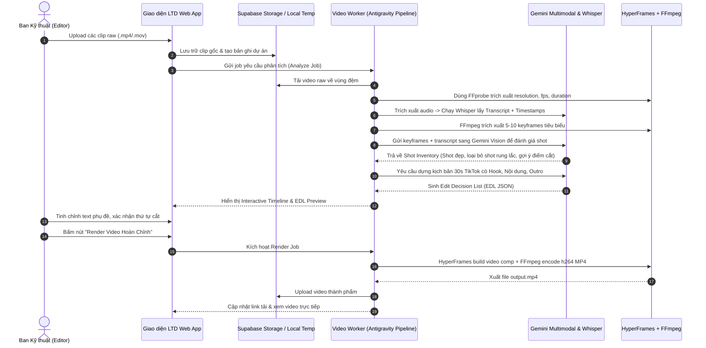

# TECHNICAL ARCHITECTURE — LTD CREATIVE STUDIO
**Dự án:** LTD Creative Studio  
**Phiên bản:** 1.0  
**Tác giả:** Antigravity Architect & AI Engineering Team  
**Ngày lập:** 23/11/2026  

---

## 1. TỔNG QUAN KIẾN TRÚC HỆ THỐNG (SYSTEM OVERVIEW)

LTD Creative Studio được thiết kế theo kiến trúc **Modern Full-stack Web Application** với khả năng xử lý tác vụ tính toán nặng (AI video rendering & media processing) qua mô hình bất đồng bộ (Asynchronous Worker Pipeline).

```mermaid
graph TD
    User([Người dùng / Trình duyệt]) -->|HTTPS / WSS| NextApp[Next.js App Router (Frontend & Server Actions)]
    
    subgraph "Application Layer (Next.js)"
        NextApp --> AuthGuard[Supabase Auth Guard & Middleware]
        NextApp --> ContentRoute[API Route: AI Content Writer]
        NextApp --> IdeaRoute[API Route: AI Creative Director]
        NextApp --> VideoRoute[API Route: Video Pipeline Manager]
    end

    subgraph "Data & Storage Layer (Supabase)"
        AuthGuard --> SupaAuth[Supabase Auth]
        NextApp --> SupaDB[(PostgreSQL + RLS)]
        NextApp --> SupaStorage[Supabase Object Storage (Media, Assets)]
        SupaDB --> PgVector[(pgvector: Knowledge Search)]
    end

    subgraph "AI Services Layer"
        ContentRoute --> AIAdapter[AI Provider Adapter]
        IdeaRoute --> AIAdapter
        AIAdapter --> GeminiAPI[Google Gemini API (Flash/Pro)]
        AIAdapter -.-> OpenAI[OpenAI API (Fallback)]
    end

    subgraph "Video Processing & Rendering Pipeline"
        VideoRoute --> JobQueue[Video Job Queue / Background Worker]
        JobQueue --> FFmpegProc[FFmpeg / FFprobe (Metadata, Proxy, Encode)]
        JobQueue --> WhisperProc[Whisper STT (Transcript & Timestamp)]
        JobQueue --> VisionAnalyzer[Gemini Vision (Shot Analysis)]
        JobQueue --> CompositionEngine[HyperFrames / Remotion Engine]
        CompositionEngine --> RenderedMP4[Final MP4 Video Output]
        RenderedMP4 --> SupaStorage
    end
```

---

## 2. STACK CÔNG NGHỆ LỰA CHỌN (TECHNOLOGY STACK)

| Thành phần | Công nghệ lựa chọn | Lý do lựa chọn |
|---|---|---|
| **Framework Frontend & Server** | **Next.js (App Router, TypeScript)** | Hệ sinh thái React mạnh mẽ, hỗ trợ Server Components, Server Actions và API routes tối ưu. |
| **Giao diện & UI System** | **Tailwind CSS + shadcn/ui + Lucide Icons** | Thiết kế linh hoạt, hiện đại (phong cách SaaS Dark/Light), hỗ trợ accessibility chuẩn WCAG. |
| **Cơ sở dữ liệu & Auth** | **Supabase (PostgreSQL, Supabase Auth)** | Hỗ trợ Row Level Security (RLS) bảo mật dữ liệu cấp dòng, Auth đa vai trò, tích hợp sẵn storage. |
| **Vector Search (RAG)** | **pgvector (trong Supabase)** | Cho phép tìm kiếm tài liệu hướng dẫn thương hiệu, quy tắc CLB để AI trích xuất ngữ cảnh chính xác. |
| **Mô hình AI (LLM & Vision)** | **Google Gemini 2.5 Flash / 1.5 Pro** | Chi phí tối ưu, cửa sổ ngữ cảnh cực lớn (1M-2M tokens), khả năng đọc hiểu ảnh/video keyframes vượt trội. |
| **Video Processing** | **FFmpeg & FFprobe (CLI)** | Tiêu chuẩn vàng trích xuất metadata, tách audio, nén proxy, ghép video, burn-in subtitle và xuất MP4. |
| **Audio Transcription** | **OpenAI Whisper (Local hoặc Whisper Cloud)** | Tách âm thoại tiếng Việt chính xác, sinh timestamp chuẩn từng từ để phục vụ cắt ghép tự động. |
| **Video Motion & Composition** | **HyperFrames (ưu tiên) / Remotion** | Dựng hoạt cảnh, layout video 9:16 (TikTok), chữ chạy tự động, hiệu ứng đồ họa bằng mã nguồn web. |
| **Canvas Graphic Engine** | **HTML5 Canvas / SVG Rendering** | Bộ dựng đồ họa tương tác kiểu Canva, quản lý layer, text, ảnh, xuất PNG/JPEG độ phân giải cao 300 DPI. |
| **AI Image Generation** | **Google Imagen 3 / Gemini SDK** | Sinh hình nền concept nghệ thuật, bối cảnh studio theo prompt mô tả trực tiếp từ trình thiết kế. |

---

## 3. GIẢI MÃ: "LÀM SAO NGƯỜI TA EDIT VIDEO BẰNG AI / CLAUDE CODE? ANTIGRAVITY LÀM ĐƯỢC KHÔNG?"

Rất nhiều người lầm tưởng rằng các mô hình AI ngôn ngữ (như Claude hay Gemini) tự mở file video lên rồi tự xuất ra file MP4 như một phần mềm Premiere. **Thực tế không phải vậy!**

### 3.1. Bản chất kỹ thuật của "AI Code Video Editing"
Quá trình AI dựng video thực chất là **Agentic Video Orchestration** (Điều phối công cụ bằng AI):
1. **AI không render pixel trực tiếp:** AI đóng vai trò **Tổng đạo diễn (Director)**. Nó đọc metadata của video, đọc transcript và xem các frame ảnh mẫu.
2. **AI sinh ra kịch bản dựng mã lệnh (EDL - Edit Decision List):**
   Thay vì bấm chuột kéo timeline, AI viết ra cấu trúc JSON hoặc code định nghĩa:
   ```json
   {
     "timeline": [
       { "source": "clip1.mp4", "start": 0.5, "end": 3.5, "speed": 1.0, "transition": "fade" },
       { "source": "clip2.mp4", "start": 12.0, "end": 16.0, "subtitle": "Khoảnh khắc đón bình minh tại Long Thành" }
     ],
     "aspectRatio": "9:16",
     "music": "ambient_beat.mp3",
     "outroLogo": "ltd_logo.png"
   }
   ```
3. **Mã nguồn và công cụ thực thi (Execution Engine):**
   Công cụ lập trình (như **HyperFrames**, **Remotion** hoặc script **FFmpeg**) nhận file kịch bản của AI và biên dịch nó thành các lệnh render pixel thực sự trên CPU/GPU để xuất ra file `.mp4`.

### 3.2. Antigravity có làm được không?
**Hoàn toàn làm được, thậm chí Antigravity còn có nhiều lợi thế vượt trội hơn:**
- **Antigravity có Terminal Sandbox & File System:** Antigravity có thể trực tiếp chạy lệnh PowerShell/Bash để gọi `ffmpeg`, `ffprobe`, `npx hyperframes` hoặc `whisper`.
- **Hỗ trợ Agent Skills:** Dự án có thể tích hợp trực tiếp skill `heygen-com/hyperframes` vào `.agents/skills/hyperframes` để Antigravity nắm vững toàn bộ quy chuẩn code tạo video.
- **Tích hợp Native Multimodal Gemini API:** Antigravity có khả năng gửi trực tiếp ảnh chụp frame video vào Gemini để AI "nhìn thấy" góc máy, màu sắc và độ nét của ảnh/video raw, từ đó ra quyết định cắt cúp chuẩn xác hơn nhiều so với việc chỉ đọc tên file.

---

## 4. CHI TIẾT PIPELINE BIÊN TẬP VIDEO (VIDEO EDITING PIPELINE)



---

## 5. THIẾT KẾ CƠ SỞ DỮ LIỆU (DATABASE SCHEMA - POSTGRESQL)

Dưới đây là thiết kế các bảng quan trọng nhất trong hệ thống:

### 5.1. Nhóm Quản trị Thành viên & Phân quyền
- **`departments`**: Lưu danh sách 2 ban chính thức (`id`, `name`, `code`, `description`, `created_at`).
  - Dữ liệu chuẩn: Ban Truyền Thông (`COMM` / `MEDIA`), Ban Kỹ Thuật (`TECH`).
- **`profiles`**: Thông tin người dùng (`id [UUID FK auth.users]`, `full_name`, `avatar_url`, `bio`, `role`, `is_active`, `created_at`).
- **`department_members`**: Liên kết thành viên với ban (`id`, `profile_id`, `department_id`, `position` [Trưởng ban/Thành viên], `generation` [Gen 1, Gen 2...], `joined_date`).

### 5.2. Nhóm Nội dung & Ý tưởng
- **`content_items`**: Lưu bài viết (`id`, `author_id`, `platform` [Facebook/TikTok], `content_type`, `title`, `body_text`, `hook_text`, `hashtags`, `status` [draft/in_review/approved/published], `scheduled_at`, `approved_by`).
- **`content_versions`**: Lịch sử chỉnh sửa bài viết (`id`, `content_id`, `version_number`, `body_snapshot`, `created_at`).
- **`idea_cards`**: Thẻ ý tưởng sáng tạo (`id`, `creator_id`, `title`, `category`, `format`, `target_audience`, `concept_summary`, `shotlist_brief`, `status`).
- **`campaigns`**: Chiến dịch lớn (`id`, `title`, `big_idea`, `start_date`, `end_date`, `status`, `target_kpi`).

### 5.3. Nhóm Dự án Video
- **`video_projects`**: Dự án video (`id`, `creator_id`, `title`, `target_platform`, `aspect_ratio` [9:16, 16:9], `status`, `final_video_url`).
- **`source_clips`**: Clip gốc đã upload (`id`, `project_id`, `file_name`, `storage_path`, `duration_sec`, `resolution`, `fps`, `proxy_url`).
- **`edit_decision_lists`**: Kịch bản dựng EDL (`id`, `project_id`, `edl_json`, `version`, `created_at`).
- **`render_jobs`**: Tiến trình render (`id`, `project_id`, `status` [queued/processing/completed/failed], `progress_percent`, `error_message`, `output_path`).

### 5.4. Nhóm Kho Tài sản & Tri thức (Knowledge & Assets)
- **`assets`**: File logo, preset, nhạc nền (`id`, `title`, `type` [logo/audio/preset/font], `file_url`, `metadata`).
- **`knowledge_documents`**: Tài liệu quy chuẩn CLB (`id`, `title`, `category`, `content_text`, `embedding [vector(1536)]`).

---

## 6. THIẾT KẾ BẢO MẬT & ROW LEVEL SECURITY (RLS)

1. **Phân quyền cấp dữ liệu (PostgreSQL RLS):**
   - Mọi người dùng đã đăng nhập đều có thể đọc bảng `departments` và danh bạ công khai `profiles` (chỉ các trường không nhạy cảm).
   - Chỉ Admin hoặc Lead của ban mới có quyền Thêm/Sửa/Xóa thành viên trong ban (`department_members`).
   - Thành viên Ban Nội dung & Ban Kỹ thuật chỉ được sửa bài viết / dự án video do mình tạo hoặc được phân công.
2. **Bảo mật File Video & Tài sản:**
   - Các file video gốc (RAW) được lưu trữ trong Supabase Private Bucket, chỉ truy cập qua Signed URL có thời hạn.
   - Video hoàn thiện (Rendered MP4) được lưu trữ tại Public/Restricted Bucket để dễ dàng xem trước và tải về.
3. **Bảo mật Biến Môi trường:**
   - Tất cả các khóa bí mật (`GEMINI_API_KEY`, `SUPABASE_SERVICE_ROLE_KEY`) chỉ lưu trong file `.env.local` ở server, không đưa vào client build.
